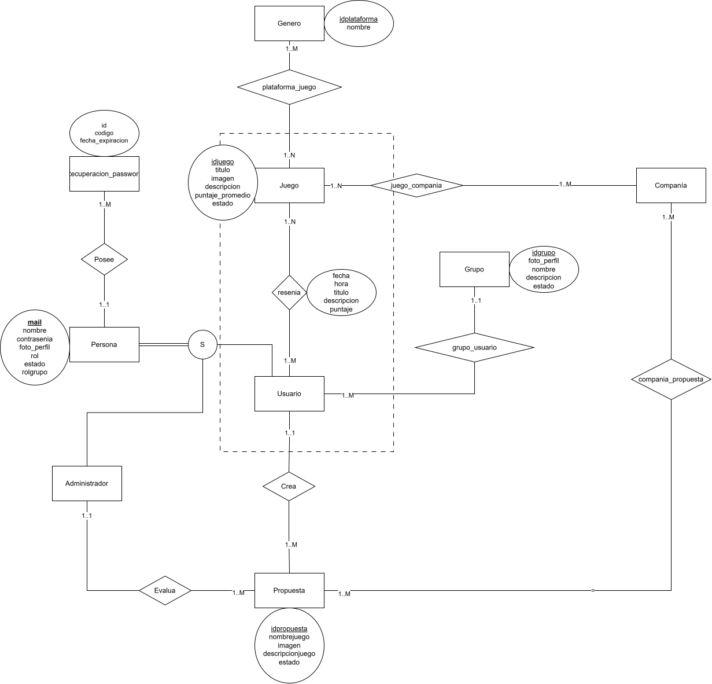
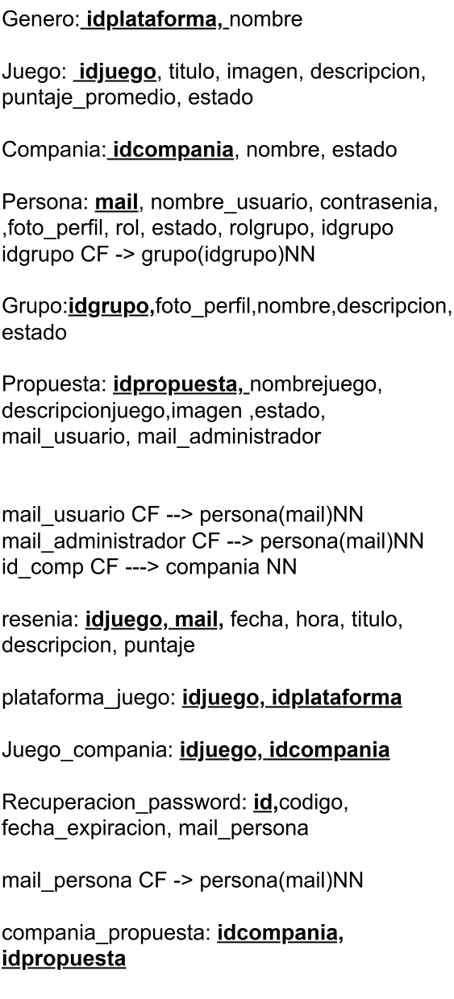

# gamerboxd_Java_TP

## Integrantes
- **52986** - Juan Bautista Perez
- **52150** - Santiago Malet

---

## Claves para acceder al sistema

Para la evaluación y prueba de las distintas funcionalidades y niveles de acceso:

### Usuario común
- **Correo electrónico:** `usuario_comun@gmail.com`
- **Contraseña:** `123`

### Usuario administrador
- **Correo electrónico:** `usuario_administrador@gmail.com`
- **Contraseña:** `123`

---

## Enunciado General

Gamerboxd es una aplicación web para poder puntuar videojuegos. Los usuarios podrán seleccionar de un amplio catálogo de videojuegos aquellos que deseen para reseñarlos. En caso de que el juego buscado no se encuentre se podrá solicitar que se agregue al catálogo. Los administradores manejan estas solicitudes y controlan si la información proporcionada es correcta. Cada usuario va a contar con su perfil, donde otros usuarios van a poder seguirlos y ver sus reseñas en su página principal.

Los usuarios pueden crear grupos de reseñadores y solicitar unirse a otros grupos. Los administradores del grupo (permisos otorgados por el creador) aceptan o niegan la petición. Estos grupos juntan muchos reseñadores y permiten a ellos publicar reseñas bajo un mismo nombre. La página del grupo mostrará su imagen de perfil, el nombre de los miembros y los juegos reseñados por ellos.

---

## Diagrama de Entidad Relación (DER)

---

## Pasaje a Tablas

---

## Checklist regularidad

| Requerimiento | Detalles |
| :--- | :--- |
| **ABMC Simple** | Usuario, Compañía |
| **ABMC Dependiente** | Juego |
| **CU NO-ABMC** | Moderación de reseña |
| **Listado simple** | Listado de juegos |

---

## Checklist promoción directa

| Requerimiento | Detalles |
| :--- | :--- |
| **ABMC** | Usuario, Juego, Compañía, Grupo, Administrador, Propuesta |
| **CU "Complejo" (nivel resumen)** | Realizar reseña |
| **Listado complejo** | Listar juegos por compañía |
| **Nivel de acceso** | Administrador, Usuario |

---

## Principales ABMCs y Funcionalidades

A grandes rasgos, el sistema articula los siguientes módulos principales:

### 1. ABMC de Usuarios y Autenticación
- **Registro e inicio de sesión:** Autenticación segura mediante encriptación con salt (**jBCrypt**) y emisión de tokens **JWT** para sesiones sin estado.
- **Recuperación de contraseña:** Flujo por correo electrónico mediante token temporal.
- **Gestión de perfil:** Modificación de nombre de usuario y avatar/foto de perfil.
- **Niveles de acceso:** Manejo de roles (`usuario` y `administrador`) con autorización en endpoints y baja lógica de cuentas.

### 2. ABMC de Videojuegos y Catálogo
- **Exploración de catálogo:** Listado general de títulos con buscador interactivo y visualización por tarjetas.
- **Ficha de juego:** Vista en detalle con portada, sinopsis, desarrolladoras asociadas, plataformas y puntaje promedio calculado dinámicamente.
- **Administración:** Alta de nuevos títulos, edición de atributos (género, descripción, precio, imagen) y baja lógica de juegos (restringido a administradores).

### 3. Gestión de Reseñas (Caso de Uso Complejo)
- **Calificación y crítica:** Los usuarios pueden calificar un videojuego (escala de 1 a 5 estrellas) y redactar una reseña argumentada.
- **Regla de integridad y autoría:** Cada usuario puede registrar como máximo una reseña por juego, con posibilidad de editarla o borrarla cuando lo desee.
- **Cálculo dinámico:** Toda creación, modificación o eliminación de una reseña recalcula y actualiza de manera automática el `puntaje_promedio` del juego en la base de datos.
- **Visualización priorizada:** En la ficha del juego, la reseña propia del usuario logueado se posiciona automáticamente en la cima con controles rápidos de edición/borrado.

### 4. ABMC de Compañías (Desarrolladoras / Distribuidoras)
- **Gestión de entidades:** Alta, modificación y baja lógica de empresas de la industria.
- **Relación N a N:** Asociación entre juegos y sus correspondientes compañías desarrolladoras y publicadoras (`juego_compania`).
- **Listados complejos:** Consulta y filtrado de títulos según la compañía seleccionada.

### 5. ABMC de Grupos de Reseñadores
- **Comunidades de usuarios:** Creación y personalización de grupos con nombre, descripción y avatar.
- **Membresías:** Solicitud de incorporación a grupos, asignación de roles internos y gestión de miembros.
- **Publicación colectiva:** Los integrantes pueden reseñar bajo el nombre del grupo, visualizándose en la sección comunitaria.

### 6. Propuestas de Juegos y Moderación (Caso de Uso NO-ABMC)
- **Solicitud de títulos:** Si un usuario no encuentra un videojuego en el catálogo, puede enviar una propuesta detallando el nombre, género, desarrollador y descripción.
- **Panel de moderación:** Los administradores acceden al listado de propuestas pendientes para evaluar su viabilidad y proceder a su aprobación (incorporando automáticamente el juego al catálogo) o rechazo.

---

## Tecnologías Utilizadas

- **Backend:** Java SE (JDK 17+) con servidor nativo `HttpServer` (RESTful), persistencia JDBC pura con MySQL Connector/J (`PreparedStatement`), autenticación JJWT, cifrado jBCrypt y serialización Google Gson.
- **Frontend:** React 19 (Vite), React Router DOM, Swiper.js y CSS modular responsivo con diseño Glassmorphism.
- **Base de Datos:** MySQL Server 8.0.
